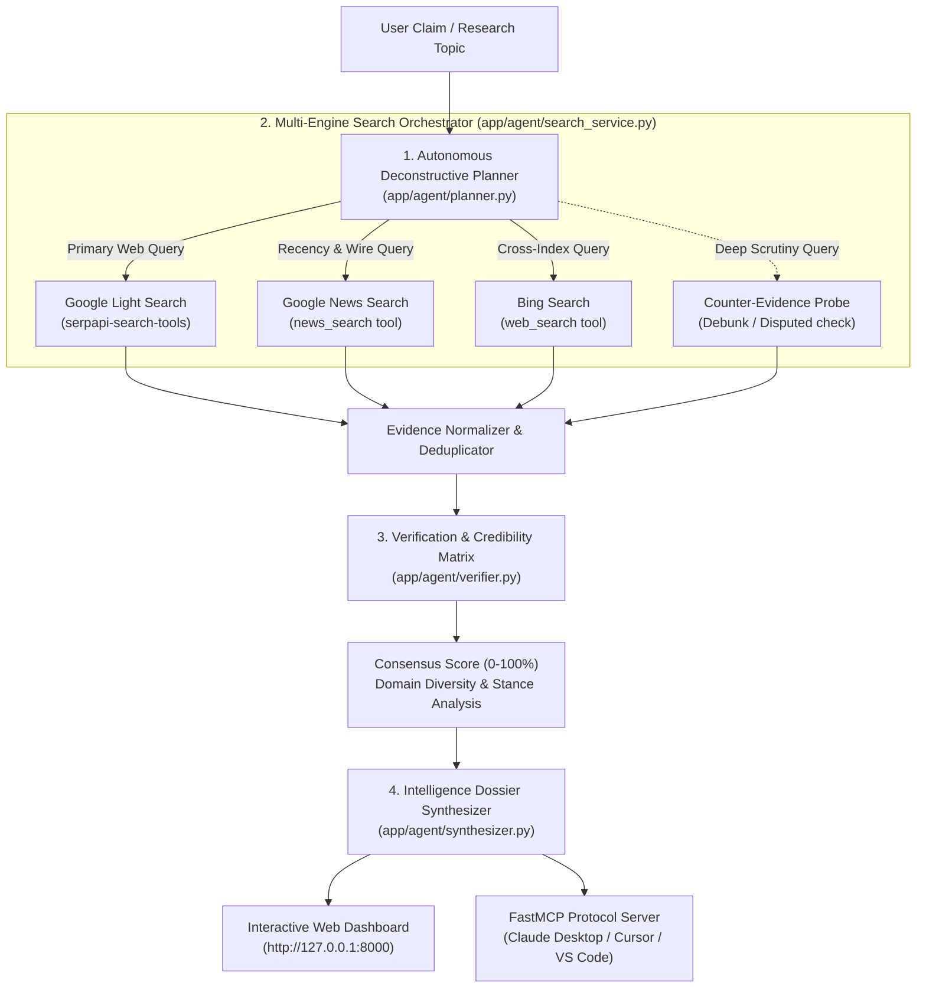

# VeriSerp AI — Autonomous Multi-Engine Intelligence & Fact-Checking Agent
> Built for the **SerpApi India Hackathon 2026** • ₹3 Lakh+ in Prizes • Submission Date: October 10, 2026

[](https://www.python.org/downloads/)
[](https://pypi.org/project/serpapi-search-tools/)
[](https://github.com/jlowin/fastmcp)
[](https://fastapi.tiangolo.com)
[](https://opensource.org/licenses/MIT)

---

## 🚀 Overview

**VeriSerp AI** is an autonomous intelligence and fact-checking agent that triangulates truth across multiple search engines and news wires using official **SerpApi search tools** (`serpapi-search-tools`) and the **Model Context Protocol (MCP)**.

In an era of information fragmentation and AI hallucinations, single-engine RAG is vulnerable to SEO manipulation and recency blindspots. VeriSerp AI solves this by:
1. **Deconstructing** complex topics into targeted multi-engine search hypotheses.
2. **Executing parallel multi-engine searches** across **Google Light** (canonical documentation), **Bing** (independent index validation), and **Google News** (fresh reporting and wire timestamps).
3. **Evaluating a multi-source consensus matrix** with domain authority weighting (Gov/PIB, Reuters, Bloomberg vs blog aggregators).
4. **Synthesizing comprehensive intelligence dossiers** with direct citations, consensus percentage gauges, and actionable takeaways.

---

## 🏛️ System Architecture



---

## 🌟 Key Highlights & Innovations

- **Official `serpapi-search-tools` Integration**: Uses the new Python agent library for lightweight, token-efficient search tool calls (`web_search`, `news_search`) with compact JSON parsing.
- **Cross-Engine Triangulation**: Eliminates single-engine bias by verifying claims across Google, Bing, and News indexes in parallel.
- **Objective Consensus Gauge**: Computes an empirical 0–100% corroboration score based on domain authority tiers, stance detection (Supporting vs Disputed vs Nuanced), and domain diversity.
- **Dual Presentation Interface**:
  - **Premium Web Dashboard**: Modern dark mode with glassmorphic cards, circular animated SVG consensus gauge, live query latency telemetry, and interactive evidence explorer.
  - **Native MCP Server**: Ready-to-use FastMCP tools (`veriserp_research`, `veriserp_verify_claim`, `veriserp_multi_search`) callable directly from Claude Desktop and Cursor.
- **Zero-Crash Evaluation Mode**: Includes built-in showcase benchmark templates (e.g. *Tata Dholera Semiconductor Fab 2026*, *ISRO Gaganyaan*, *OpenAI o3 vs DeepSeek R1*, *Quantum Computing Fact-Check*), allowing hackathon judges to test the agent immediately with or without a private API key.

---

## ⚡ Quick Start

### 1. Prerequisites
- **Python 3.10+** (Tested on Python 3.12)
- **uv** (recommended) or standard `pip`

### 2. Clone and Install Dependencies

```bash
git clone https://github.com/your-username/serp-project.git
cd serp-project

# Using uv (fastest)
uv sync

# Or using pip
pip install -r requirements.txt
```

### 3. Configure API Keys (Optional)

Copy `.env.example` to `.env`:

```bash
cp .env.example .env
```

Edit `.env`:
```ini
# Get your free key at: https://serpapi.com/manage-api-key
SERPAPI_API_KEY=your_serpapi_api_key_here

# Optional LLM keys (if omitted, VeriSerp's Native Heuristic Synthesizer runs automatically)
# GEMINI_API_KEY=
# OPENAI_API_KEY=
```

> 💡 **Tip:** You can also enter and validate your SerpApi key directly in the Web UI via the **API Key** settings button!

### 4. Launch the Application

```bash
# Using uv
uv run python run.py

# Or on Windows using batch script
start.bat
```

Open your browser to:
👉 **[http://127.0.0.1:8000](http://127.0.0.1:8000)**

---

## 🔌 Model Context Protocol (MCP) Integration

VeriSerp AI includes a native FastMCP server in [`app/mcp_server.py`](file:///c:/Users/avyay/serp-project/app/mcp_server.py) and seamlessly complements the hosted SerpApi MCP server.

### Connect VeriSerp to Claude Desktop / Cursor

Add to your `claude_desktop_config.json`:

```json
{
  "mcpServers": {
    "veriserp": {
      "command": "uv",
      "args": ["run", "python", "-m", "app.mcp_server"],
      "env": {
        "SERPAPI_API_KEY": "YOUR_SERPAPI_API_KEY"
      }
    }
  }
}
```

### Official Hosted SerpApi MCP Server

Alternatively, connect directly to SerpApi's hosted endpoint:

```json
{
  "mcpServers": {
    "serpapi": {
      "type": "http",
      "url": "https://mcp.serpapi.com/YOUR_SERPAPI_API_KEY/mcp"
    }
  }
}
```

---

## 📂 Project Structure

```
serp-project/
├── app/
│   ├── __init__.py
│   ├── main.py                  # FastAPI server & REST API
│   ├── config.py                # Environment & configuration settings
│   ├── mcp_server.py            # FastMCP server exposing research tools
│   ├── agent/
│   │   ├── __init__.py          # Coordinator: VeriSerpAgent
│   │   ├── planner.py           # Claim deconstruction & query planning
│   │   ├── search_service.py    # serpapi-search-tools parallel executor
│   │   ├── verifier.py          # Credibility & consensus calculation
│   │   └── synthesizer.py       # Dossier synthesis (LLM + Native fallback)
│   └── static/
│       ├── index.html           # Modern responsive dashboard
│       ├── app.css              # Custom styling (glassmorphism, animations)
│       └── app.js               # Reactive frontend logic & telemetry
├── .env.example                 # Environment template
├── pyproject.toml               # uv / pip project definitions
├── requirements.txt             # Exported pip requirements
├── run.py                       # Launch entrypoint
├── start.bat                    # Windows 1-click startup script
└── README.md                    # Project documentation
```

---

## 🏆 Hackathon Reference Links

- **SerpApi MCP Integration**: [serpapi.com/integrations/mcp](https://serpapi.com/integrations/mcp?utm_source=india_hackathon_26)
- **SerpApi Search Tools Python**: [serpapi.github.io/serpapi-search-tools-python](https://serpapi.github.io/serpapi-search-tools-python/?utm_source=india_hackathon_26)
- **SerpApi Dashboard & Keys**: [serpapi.com/manage-api-key](https://serpapi.com/manage-api-key)

---

## 📄 License

This project is licensed under the MIT License — see the [LICENSE](LICENSE) file for details.
